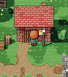

# V6-02：v5移植の検証記録とM0実機確認

更新日：2026-11-07。[Issue #4](https://github.com/formulaText/pixel-rig/issues/4)。M0は依頼者のiPhone 17 Safari実機確認待ち。クラウド環境の結果をiPhoneの60fps達成・実機承認とは扱わない。

## 実装と維持した条件

研究アプリ自体にv5を移植し、Three.jsはnpmの0.128.0を使用する。iframeや原本スクリプトの実行で代用しない。GLSLはTypeScriptの文字列としてバンドルし、Three.js・色・模様・顔・アイコン・デカールの生成データを成果物へ含める。実行時の外部依存はない。

|場所|責務|
|---|---|
|src/core/|原本の定数・既定値・データと共有型|
|src/materials/|共有uniform、色ランプ、マテリアル|
|src/world/|固定seedのマップ・建物・木・小物・当たり判定、描き込み層|
|src/character/|リグ・ポーズ、顔アトラス、瞬き・感情|
|src/render/|GLSL、renderer、影・照明、後処理、単体／ワールド描画と再構築|
|src/gameplay/|共有ピクセル位置、移動と既存60Hzロジック|
|src/input/|WASD／矢印／ドラッグ入力、既存の自動歩行|
|src/ui/|v5の設定操作|
|src/debug/|比較ストリップ、readPixels、PNG焼き出し|
|src/main.ts|起動、既存のRAFループ、ビルド識別情報|

原本のカメラ、キャラとカメラの共有整数座標、奇数サイズの画素境界、DPR整列、斜めの丸め、方向ヒステリシス、8ティック保持、60Hz（最大6ティック）、4コマ歩行を維持した。模様の展開・隣接セル判定、色管理、影のテクセルスナップ、α=0.6の顔マスク、分類IDと深度の使い分けも同じ。

描画は影→ワールド→デカール→足元影→キャラ→法線深度→後処理→比較の順序を維持する。主画面の層間で深度を消去しない。比較は元の偶数／奇数フレーム切替、PNGは昼・8方向×4コマを維持する。

追加したビルドID・元コミット・日時・「入口へ戻る」は、スクロールできる設定パネルの末尾に配置した。ゲーム描画領域・ジョイスティックと重ならず、元のステージ寸法も変えない。TypeScriptはstrictのまま、データのunion／tuple、描画オプション、Three.js・DOM型を追加。DOMへの数値代入は同じ文字列に明示変換した。

原本、壁際の既知問題、Three.js更新、照明刷新、楕円当たり判定、複数キャラ、新規の検証UIは変更・実装していない。

## 原本比較の方法

開発者側で `npm ci` → `npm run check` → `CHROMIUM_PATH=/usr/bin/chromium npm run test:browser` を実行する。Chromiumが別の場所ならCHROMIUM_PATHを設定する。ブラウザ自動化は固定したplaywright-core 1.57.0を使用。利用者のiPhoneにターミナル操作を要求するものではない。

`tests/browser/compare-v5.mjs` は原本を毎回読み、`work/v6-02/reference.html` に検証用コピーを作る。原本そのものは変更しない。加工内容は以下のとおり。

1. 原本コピーのcdnjs参照だけを、同じr128のnpm内UMDファイルへ差し替える。移植版はnpmのESMを使う。原本公開用HTMLのCDN参照は維持する。
2. コピーのクロージャ内に、状態の読み取り・既存の位置設定／リサイズ関数へのテスト用参照を追加する。GLSL、ロジック、描画関数は変更しない。
3. 移植版には検証サーバーのtransformだけで同等の参照を注入する。srcや配信成果物にはwindow.__rig等を追加しない。
4. 両ページのRAFを手動化し、performance.nowの原点を0、時刻刻みを1000/60msに揃える。30ティックを超える長い遷移では、両者の既存tick関数を同じ回数直接呼び、最後の2フレームを描画して選択時刻の状態・画素を比較する。中間すべてのフレームの画素一致を主張する検査ではない。8方向移動等の短い区間はRAFの連続フレームを使う。自動歩行再開では明示的に4秒のRAF間隔を入れてdt上限・最大6ティック・操作後3秒保持も比較する。両ページ初期化後にMath.randomをseed 20261107へ戻す。マップ乱数は原本どおりmulberry32(11)。UUID生成の呼出回数を瞬き等の乱数へ混入させない。
5. 同じCSS viewport・DPR、キャラ位置、設定、キー／pointer操作、経過フレーム数を与える。静止・設定変更では比較表示ON、感情・瞬き・移動・自動歩行の連続フレームではOFFにし、前後でONへの復帰も確認する。主画面のRGBAバイト、比較ストリップ8枚、状態・カメラ行列、PNGデータを一致判定する。
6. 縦393×852／DPR3、横852×393／DPR3、デスクトップ1281×801／DPR1.25を検査し、起動後の縦横入替も行う。デスクトップの奇数サイズ・非整数DPRも同条件で検査する。

検証コピー・画像・全ケース結果はwork/に生成され、配信しない。テスト専用の位置設定・時刻進行は利用者UIとして存在せず、下記実機手順には使用しない。

## 検証結果

Node 24.22.1／npm 11.9.0、Chromium 156.0.8078.79（Linux／SwiftShader）で実施。結果の集計は[検証記録JSON](validation/V6-02.json)。

|検査|結果|
|---|---|
|npm ci → 原本照合・strict型検査・ビルド・テスト|成功。既存配信テスト6件＋原本再現検査3件＝9件成功|
|原本18件のSHA-256|全件一致。保護対象ディレクトリに変更なし|
|GLSL・定数／データ・主要43関数|文字列／型消去後の処理が原本と一致|
|3画面条件の主画面・状態・カメラ比較336件|RGBA差分0バイト、状態・カメラ行列一致|
|顔比較3枚・段階比較5枚|比較ON時の更新結果一致、OFF／再開も一致|
|PNG比較21件|全件バイト一致。4解像度・3顔方式、8方向×4コマ|
|計357件の比較|説明できない差分なし。選択時刻の比較で、中間全フレームの画素一致を保証しない|
|配信成果物の候補／確認済み相対パス|縦横393×852／852×393・DPR3で起動、ID・コミット照合、再読込、入口復帰成功|
|タッチ相当のUI操作・PNGダウンロード|Chromiumモバイル設定で成功。Safari実機の保存動作は未検証|
|JS・HTTP・コンソール、アセット|エラー0。研究アプリへの外部アセット要求0。原本コピーだけ同一r128をローカル参照|

昼夕夜、影、感情6種の開始／動作／終了、瞬き、自動歩行、模様0／50／100、解像度16／24／32／48、倍率2／7／4、顔3種、変換1〜4、8方向の整数／連続移動と停止、ドラッグと解放、4秒の間隔後の復帰、縦横変更を比較した。比較前の位置は村・井戸・壁・樹木・水辺に同じ値を設定した。

|壁際・原本コピー|壁際・移植版|
|---|---|
|||

[32px設定の一致したPNG](validation/portrait-png-32.png)／[奇数サイズ・非整数DPRから向きを変えた移植版](validation/desktop-rotated-port.png)。画像はテスト用の選択時刻であり、実機承認用ビルドではない。

Three.js本体をバンドルしたJSは約571kB（gzip約149kB）。Viteの500kB注意表示はあるが、必要な依存を含めた正常なビルド成果物で、実行時CDNへ分離していない。Git archive検査はstdoutの既定1MiB上限を避けてファイルへ直接出力し、同じ配信全体の照合を維持した。

## 既知問題・差分・未検証事項

- 壁際で頭や体が建物に重なる既知問題は原本同様に残す。壁を奥の板へ寄せる深度と半径0.3の円判定を維持し、V6-06の修正は混ぜない。
- 影用背景パスの葉の切り抜き未反映、キャラが投影影の対象外で足元影のみ、分類IDが物体固有IDではない点も原本同様。
- 通常起動の瞬き・感情はMath.randomと実経過時間に依存する。別タブの見た目が一瞬違っても、時刻差やランダム動作を先に切り分ける。
- 追加した識別情報、ブラウザタイトル、CDNから成果物内依存への変更は意図した差分。ステージ寸法と元の操作は維持する。
- 本比較はreadPixelsを使うデバッグ測定。通常動作の性能測定やiPhone性能の証明ではない。V6-02には性能測定開始／停止等の新しいボタンはない。HUDのfpsは原本の平滑化表示で、GPU処理時間ではない。
- iPhone Safariの実描画、タッチ操作、PNG保存の実機挙動、60fpsの維持、熱による長時間変化、Safari固有の色・GPU差は依頼者確認待ち。

## 候補公開（依頼者の操作）

1. PRの変更内容・Checksを確認する。M0の確認前にIssue #4を閉じない。今回Codexはマージ・公開・昇格を実行しない。
2. GitHubの「Actions」→「Pages - candidate or promote」→「Run workflow」を開く。「Use workflow from」は **main**、operationは **candidate**。
3. source_refは **codex/v6-02-r128-baseline**、またはPR／完了報告の完全コミットSHAを入力。expected_build_idは空、iphone_approvedは未チェックで実行する。フォームで支障がある場合はSafariの「デスクトップ用Webサイトを表示」へ切り替える（原因未確定）。
4. build／publishの緑のチェックを確認し、「Summary」の公開リンクへ進む。入口の候補ビルドIDを記録して「検証候補」を開く。設定パネルを下へスクロールし、末尾のビルドID・元コミットを照合する。
5. 「入口へ戻る」→「原本v5」を開き、次の手順で交互に比較する。確認済み版はV6-01の起動土台なので、V6-02の描画比較先は原本v5にする。

## iPhone 17 SafariでのM0確認

まず縦向きで候補と原本を開き、同じ「キャラの解像度」「ドットの大きさ」「時間帯」「顔の表現」「変換ステップ1〜4」にする。画面内をドラッグして移動する。パネルは上下にスクロールできる。「自動歩行デモ」をOFFにすると停止して見比べやすい。ランダム差の切り分けでは「自動まばたき」をOFFにして感情が終わるまで待つ。水や葉は時刻で動くので、別タブの一瞬の波・葉だけの違いを移植不具合と即断しない。

1. **村・井戸・壁・樹木・水辺**：初期位置付近の村と井戸、家の正面・左右・角、木の前後、水辺までドラッグして進む。レンガ・板・瓦・井戸の石模様、葉、草、水面、花・ひび等の描き込み、足元影、前後関係を見比べる。壁際の問題は「原本にもある／候補だけ」のどちらかを記録する。
2. **8方向移動**：上・右上・右・右下・下・左下・左・左上へ順にドラッグし、止める。歩行4コマ、足元とカメラの同期、斜め移動、向きの急な切替や停止後の振動を比べる。「自動歩行デモ」ONで村の移動も比べる。
3. **昼／夕方／夜と影**：「時間帯」の3つを順に押す。「建物や木の影」をOFF／ON。影の位置・色、夕方と夜の街灯を確認する。キャラの足元影はこのスイッチで消える影とは別。
4. **感情6種と瞬き**：「喜び」「驚き」「疑問」「落ち込み」「怒り」「焦り」を1つずつ押し、アイコン・目・眉・全身モーションと終了を比べる。「自動まばたき」をONに戻し、開眼→細目→閉眼→復帰を確認する。原本と同じ瞬間に始まる必要はない。
5. **模様の展開**：「曲面の模様」の「展開の強さ（既定値）」スライダーを0／中間／100へ動かす。井戸・樽・木の幹の曲面で模様・目地が欠けたり揺れたりする差がないかを見る。
6. **解像度・顔・変換ステップ**：「キャラの解像度」の16／24／32／48を順に押す。「顔の表現」の3D／デカール／ドット顔を比べ、ステップ1〜4を1つずつOFF／ON。顔比較3枚と段階比較5枚の表示も確認する。OFF時に滑らかさや輪郭が変わること自体は元の機能。
7. **ドット倍率・縦横**：「ドットの大きさ」を最小2／最大7で比較する。各端で縦→横→縦に回し、画面の欠け、配置、ドットの太さ・にじみ、ドラッグとパネル操作を確認。倍率4・解像度32へ戻して再読込し、初期設定と識別情報を確認する。
8. **比較表示**：「比較表示を更新」をOFFにし、比較欄が止まって主画面が動き続けることを確認。ONで再開する。通常動作のfpsを記録する場合は比較OFF、PNGダイアログを閉じ、画面録画も止める。比較ONまたは録画中の値は別の記録にする。
9. **PNG焼き出し**：パネル末尾近くの「スプライトシートを焼き出す（8方向×4コマ）」を押す。「スプライトシート」画面で8行×4列を確認し、「PNGを保存」を押す。Safariが確認を出したら「ダウンロード」を選び、Safariのダウンロード一覧または「ファイル」アプリのダウンロード先から `sprite_sheet.png` を開く。画像だけの表示になった場合は共有メニューの「“ファイル”に保存」で保存する。候補と原本を区別できる名前で保存する（同名の上書きに注意）。「閉じる」で戻り、移動と比較が継続することも確認。

PNGは昼の光、現在のステップ1〜3・顔設定で出力される。解像度16→64×128、24→96×192、32→128×256、48→192×384px。行は下・右下・右・右上・上・左上・左・左下、各行4コマ。透過背景はSafariの画像表示では白／黒に見える場合がある。原本側でも同じ設定で保存し、向き・コマ・顔・輪郭・透過の差を確認する。色や形に候補だけの差、保存不能、ダイアログから戻れない等があれば報告する。

## 実機結果の報告と次の判断

Issue #4またはPRへ、候補ビルドID・元コミット、iPhone／iOS／Safari、縦横、各手順のOK／NGを記録する。問題があれば場所・操作順・設定・原本でも出るかを添える。fpsは比較更新ON／OFF・録画有無・測定した時間・経過時間と一緒に記録し、目視の動きと数値を区別する。

M0の実機結果が揃うまでは「実機確認待ち」。マージ・確認済み版への昇格は依頼者の判断と明示承認後の別操作にする。V6-01の確認済み成果物を今回の作業で書き換えない。
